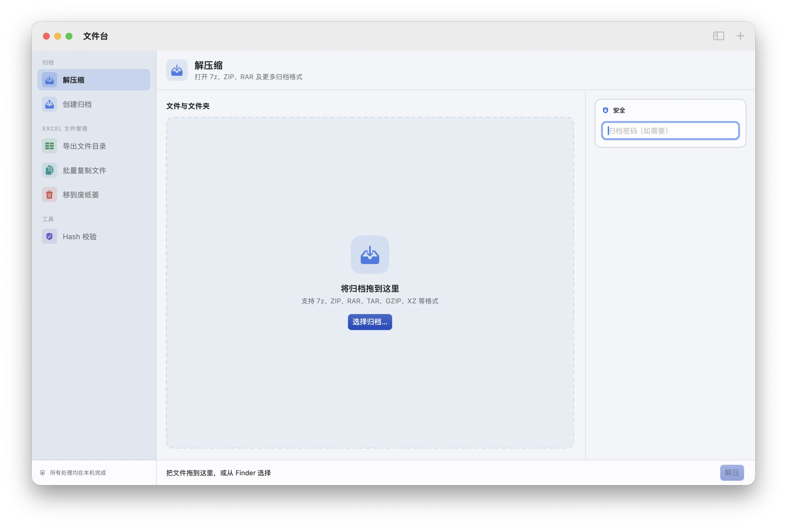

# FileNest

English · [简体中文](README.md)

[](https://985860612.github.io/FileNest/en/)
[](https://github.com/985860612/FileNest/releases/latest)
[](LICENSE)

A native file workspace for macOS with archive creation, extraction and browsing, Finder actions, Excel-based file management, and hash verification. FileNest loads the 7-Zip SDK 26.02 in process through a C ABI. It never launches `7z`, `7zz`, or another archive command-line process.

[Product website](https://985860612.github.io/FileNest/en/) · [Download](https://github.com/985860612/FileNest/releases/latest) · [Report an issue](https://github.com/985860612/FileNest/issues)



## Highlights

- Create 7z, ZIP, and TAR; extract 7z, ZIP, RAR, TAR, GZIP, BZIP2, and XZ
- Configure passwords, compression level, 7z dictionary size, and custom 7z/ZIP/TAR volumes
- Open an archive without extracting it, then browse one directory level at a time with search and familiar file icons
- Finder actions for extraction, 7z/ZIP creation, and XLSX folder-inventory export
- Exclude `.DS_Store`, `._*`, `__MACOSX`, and related macOS metadata by default
- Compute and verify MD5, SHA-1, SHA-256, and SHA-512 locally
- Export XLSX inventories, batch-copy paths, or move matching files to the macOS Trash
- Live progress, current-file reporting, cancellation, path-traversal protection, and transactional archive output
- Universal 2 support for Apple silicon and Intel Macs

RAR is read-only. To extract a split archive, select its `.001` volume; FileNest checks for missing parts and combines them locally.

## Install

Download the Universal 2 archive from [Releases](https://github.com/985860612/FileNest/releases/latest), unzip it, and move `文件台.app` to `/Applications`.

This open-source build is not notarized. If Gatekeeper blocks the first launch, Control-click the app in Finder and choose **Open**.

## Finder actions

1. Move `文件台.app` to `/Applications` and launch it once.
2. Select files or folders in Finder and open **Quick Actions** or **Services**.
3. If the actions are hidden, enable the FileNest entries under **System Settings → Keyboard → Keyboard Shortcuts → Services → Files and Folders**.

Finder actions open dedicated task windows without flashing the main window. Compression parameters such as password, dictionary, and volume size are available in the dedicated archive window.

## Build

Requirements: macOS 13+, a full Xcode installation, Swift 6, `curl`, and `make`.

```bash
git clone https://github.com/985860612/FileNest.git
cd FileNest
./scripts/build-app.sh
open "dist/文件台.app"
```

The build downloads the official 7-Zip 26.02 source archive, verifies its SHA-256 digest, builds arm64 and x86_64 full-format modules and bridge libraries, assembles a Universal 2 app, and applies an ad-hoc signature. Downloaded sources and build products stay under `.build/`.

## Develop and verify

```bash
DEVELOPER_DIR=/Applications/Xcode-beta.app/Contents/Developer swift test -j 1
./scripts/build-engine.sh
./scripts/engine-smoke.sh
SEVENZIP_ENGINE_INTEGRATION=1 swift test
./scripts/build-app.sh
```

Architecture: `SwiftUI / AppKit / Finder Services → ArchiveEngine → libsevenzipbridge.dylib → 7-Zip Format7zF`.

## Privacy and security

- No network access, file uploads, telemetry, or administrator privileges
- No shell or archive command-line invocation
- Absolute and parent-directory archive paths are rejected
- Archive outputs move from `.partial` only after successful completion
- Finder extraction creates a new sibling folder by default to avoid overwriting existing files

Please report security issues privately as described in [SECURITY.md](SECURITY.md).

## Contributing and license

Issues and pull requests are welcome. See [CONTRIBUTING.md](CONTRIBUTING.md) for the development workflow.

Original FileNest Swift application code is available under the [MIT License](LICENSE). The 7-Zip engine and derivative bridge follow the GNU LGPL, while RAR decoding is additionally subject to the unRAR restriction. See [THIRD_PARTY_NOTICES.md](THIRD_PARTY_NOTICES.md) and [`ThirdParty/7zip/`](ThirdParty/7zip/) for details.
