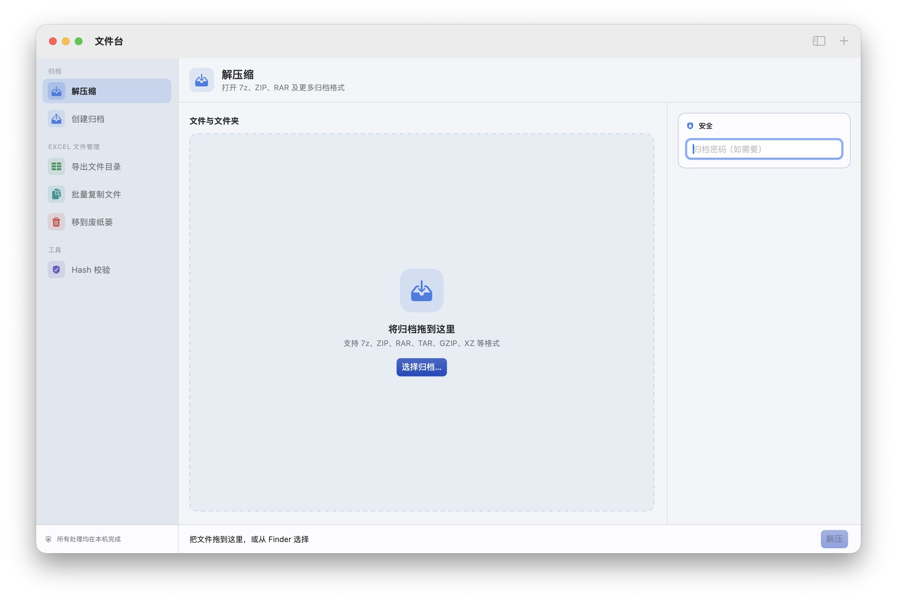

# FileNest（文件台）

[English](README.en.md) · 简体中文

[](https://985860612.github.io/FileNest/)
[](https://github.com/985860612/FileNest/releases/latest)
[](LICENSE)

面向 macOS 的原生文件工作台，提供压缩解压、归档浏览、PP-StructureV3 文档识别、NCM 音频恢复、Finder 右键操作、Excel 文件管理与 Hash 校验。归档与识别均由原生 SDK 在进程内完成，不启动 Python、`7z`、`7zz` 或其他处理子进程。

[产品官网](https://985860612.github.io/FileNest/) · [下载最新版](https://github.com/985860612/FileNest/releases/latest) · [反馈问题](https://github.com/985860612/FileNest/issues)



## 主要功能

- 创建 7z、ZIP 和 TAR；解压 7z、ZIP、RAR、TAR、GZIP、BZIP2 和 XZ
- 支持密码、压缩等级、7z 字典大小和 7z/ZIP/TAR 自定义大小分卷
- 打开归档但不解压，按目录逐层浏览、搜索并显示常见文件类型图标
- Finder 快速操作：解压到同名文件夹、压缩为 7z/ZIP、导出文件夹 XLSX 清单
- 默认排除 `.DS_Store`、`._*`、`__MACOSX` 等 macOS 元数据
- 本地计算和校验 MD5、SHA-1、SHA-256、SHA-512
- 在本机批量恢复 NCM 中的原始 MP3/FLAC，不上传、不重新编码；支持标题、歌手、专辑和封面元数据
- 导出 XLSX 文件目录，并按 XLSX 路径列批量复制或移动到废纸篓
- 检测并修复缺失的文件扩展名，按正则批量复制，并预览清理文件与目录名称
- 批量压缩、等比例缩放图片并转换为 JPEG、PNG、HEIC 或 WebP
- 图片转 PDF；按自定义关键字排序合并 PDF/图片；按关键字拆分文字型 PDF
- 用正则批量提取 PDF 文本到 XLSX，并按指定 Excel 列分组、去重、合并
- 独立“文字识别（OCR）”入口只加载 PP-OCRv5 检测与识别两个模型，跳过版面、阅读顺序、表格、公式和图表分析
- 原生 PP-StructureV3 批量识别图片/PDF：PP-OCRv5、版面、阅读顺序、方向/矫正及有线/无线表格；导出 JSON、Markdown、HTML、DOCX、XLSX
- 共享模型会话与批量并发（默认 2）；界面显示总耗时、吞吐、P50/P95，模型下载后逐文件处理可离线完成
- 目录清单可包含目录、父目录、实际文件类型、字节数、创建时间和修改时间
- 实时进度、当前文件、任务取消、路径穿越防护和事务式归档输出
- Universal 2：同时支持 Apple silicon 和 Intel Mac

RAR 仅支持读取和解压，不支持创建。分卷归档解压时请选择 `.001`，FileNest 会检查缺卷并在本机组合后处理。

## 安装

从 [Releases](https://github.com/985860612/FileNest/releases/latest) 下载 Universal 2 压缩包，解压后把 `文件台.app` 移到 `/Applications`。

首次安装的未公证开发版本如被 Gatekeeper 阻止，可在 Finder 中右键应用并选择“打开”。

## Finder 右键菜单

1. 把 `文件台.app` 移到 `/Applications` 并启动一次。
2. 在 Finder 选择文件或文件夹，打开“快速操作”或“服务”。
3. 如果菜单未显示，到“系统设置 → 键盘 → 键盘快捷键 → 服务 → 文件与文件夹”启用 FileNest 操作。

快速操作会打开专用的压缩、解压或导出窗口，不会先闪现主窗口。需要密码、字典或分卷参数时可在专用压缩窗口中调整。

## 构建

要求：macOS 13+、完整 Xcode、Swift 6、`curl`、`make`。

```bash
git clone https://github.com/985860612/FileNest.git
cd FileNest
./scripts/build-app.sh
open "dist/文件台.app"
```

构建脚本下载官方 7-Zip 26.02 与 libwebp 源码包并校验 SHA-256，分别编译 arm64 与 x86_64 产物，再组装 Universal 2 应用、`dist/cli/filenest-cli`、`dist/mcp/filenest-mcp` 和各自运行库，并临时签名。第三方源码与中间产物只保存在 `.build/`。

## CLI / MCP 接口

`filenest-cli` 的 stdout 只写最终 JSON，模型下载进度与错误以 JSON 写入 stderr。`filenest-mcp` 是原生 stdio JSON-RPC server，不依赖 Python，也不会启动 `7z` 子进程。

```bash
dist/cli/filenest-cli version
dist/cli/filenest-cli tools
dist/cli/filenest-cli run hash_compute \
  --arguments '{"files":["/tmp/example.zip"],"algorithm":"SHA-256"}'
dist/cli/filenest-cli models status
dist/cli/filenest-cli models download
dist/cli/filenest-cli models download --ocr-only --model-size mobile
dist/cli/filenest-cli recognize --ocr-only --input ./scans --output ./ocr-results \
  --format markdown --model-size mobile --provider cpu
dist/cli/filenest-cli recognize --input ./documents --output ./results \
  --format markdown --jobs 2
```

MCP 共暴露 22 个工具，覆盖归档创建/列表/解压、Hash、XLSX 目录与批量文件操作、扩展名修复/正则复制/名称清理、图片处理、PDF 转换/合并/拆分/正则提取/签名、Excel 分组合并、NCM 转换以及 PP-StructureV3 模型与识别。重命名、移到废纸篓、扩展名修复、名称清理和替换原图必须显式传入 `confirm=true`。

安装应用后，Claude Desktop 可使用以下配置：

```json
{
  "mcpServers": {
    "filenest": {
      "command": "/Applications/文件台.app/Contents/MacOS/filenest-mcp"
    }
  }
}
```

Codex 的 `~/.codex/config.toml` 配置：

```toml
[mcp_servers.filenest]
command = "/Applications/文件台.app/Contents/MacOS/filenest-mcp"
```

也可把命令替换为发行包中 `dist/mcp/filenest-mcp` 的绝对路径；必须连同同目录的 `Frameworks` 一起移动。工具参数通过 MCP 的 `inputSchema` 自描述，可先调用 `tools/list` 查看完整清单。

支持 `json|markdown|html|docx|xlsx`；可重复传入 `--input`。`--ocr-only` 仅运行 PP-OCRv5 检测与文字识别；用 `--model-size mobile|server` 切换约 21 MiB 的 Mobile 小模型或约 165 MiB 的 Server 大模型。Server 可配 `--provider coreml|cpu`，默认 CoreML；Mobile 固定使用 CPU，因为 Mobile + CoreML 在结果一致性校验中出现严重乱码，CLI/MCP 和核心服务都会拒绝该组合。MCP 对应传 `mode="ocr"`、`modelSize="mobile"|"server"` 与 `provider="coreml"|"cpu"`。

同一张 1656×1968 中文截图的冷进程实测如下；耗时取核心识别计时，RSS 取 `/usr/bin/time -l` 峰值：

| 模型 | 推理 | 耗时 | 峰值 RSS | 结果 |
| --- | --- | ---: | ---: | --- |
| Mobile | CPU | 3.12 秒 | 420 MiB | 完整 31 行，速度/内存优先 |
| Server | CoreML | 3.39 秒 | 3.21 GiB | 完整 31 行，与 CPU 仅 2 处项目符号差异 |
| Server | CPU | 8.62 秒 | 1.38 GiB | 完整 31 行，精度基准 |

复用同一模型会话连续处理 5 张图时，Mobile + CPU 为 15.62 秒（0.320 张/秒、648 MiB），Server + CoreML 为 15.18 秒（0.329 张/秒、3.71 GiB），Server + CPU 为 43.35 秒（0.115 张/秒、2.11 GiB）。因此 Mobile + CPU 的批量吞吐接近 Server + CoreML，但峰值内存约为后者的六分之一。

完整结构识别仍固定使用已验证的 Server + CPU 路径；`--jobs 2` 是 M 系列 Mac 的推荐平衡配置，`--jobs 4` 吞吐更高但峰值内存明显增加。

自动下载的 11 个校验模型覆盖 OCR、版面、阅读顺序、方向/矫正和有线/无线表格。公式与图表生成模型按上游许可单独提供时，可放到模型目录的 `Formula/{encoder.onnx,decoder.onnx,tokenizer.json}` 与 `Chart/{encoder.onnx,decoder.onnx,prompt_ids.txt,tokenizer.json}`；SDK 会惰性加载，CLI 用 `--charts` 开启图表生成。

## 开发与验证

```bash
DEVELOPER_DIR=/Applications/Xcode-beta.app/Contents/Developer swift test -j 1
./scripts/build-engine.sh
./scripts/engine-smoke.sh
SEVENZIP_ENGINE_INTEGRATION=1 swift test
./scripts/build-app.sh
```

架构：`SwiftUI / AppKit / filenest-cli / filenest-mcp → FileNestKit / FileNestOCRCore → PaddleOCRCoreML / ONNX Runtime / 7-Zip SDK`。

## 隐私与安全

- 除用户主动下载并校验识别模型外，不联网、不上传文件、不采集遥测，不要求管理员权限
- 不调用 shell 或归档命令行程序
- NCM 转换只恢复文件中已有的音频数据，请仅处理你有权使用的文件
- 拒绝归档条目中的绝对路径和 `..` 父目录路径
- 输出归档只有完整成功后才从 `.partial` 改为最终文件名
- Finder 解压默认写入新的同名目录，避免覆盖已有文件

安全问题请按 [SECURITY.md](SECURITY.md) 私下报告。

## 贡献与许可

欢迎提交 Issue 和 Pull Request，开发流程见 [CONTRIBUTING.md](CONTRIBUTING.md)。

FileNest 的原创 Swift 应用代码采用 [MIT License](LICENSE)。7-Zip 核心及派生桥接层遵循 GNU LGPL；RAR 解码代码还受 unRAR 限制。完整声明见 [THIRD_PARTY_NOTICES.md](THIRD_PARTY_NOTICES.md) 和 [`ThirdParty/7zip/`](ThirdParty/7zip/)。
